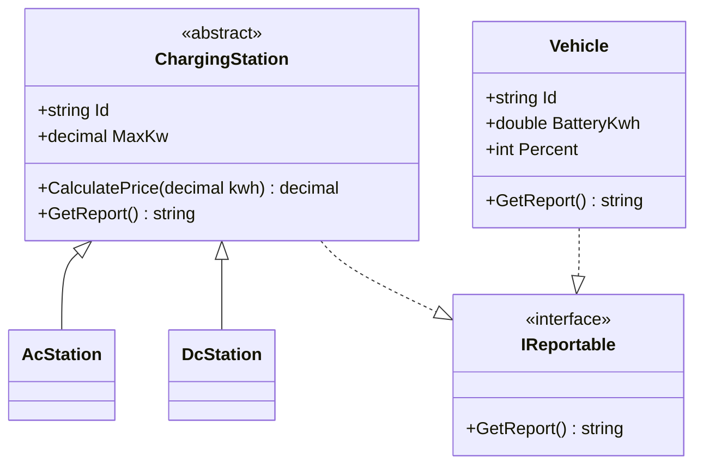

# ChargeHub Pricing

Ett C#-konsolprogram som beräknar dagens intäkter
från AC- och DC-laddstationer.

## Prissättning

- AC: 3,50 kr per kWh
- DC: 5,00 kr per kWh plus 10 kr i startavgift

## Klassdiagram

## Resultat

Dagens intäkter: 432 kr.